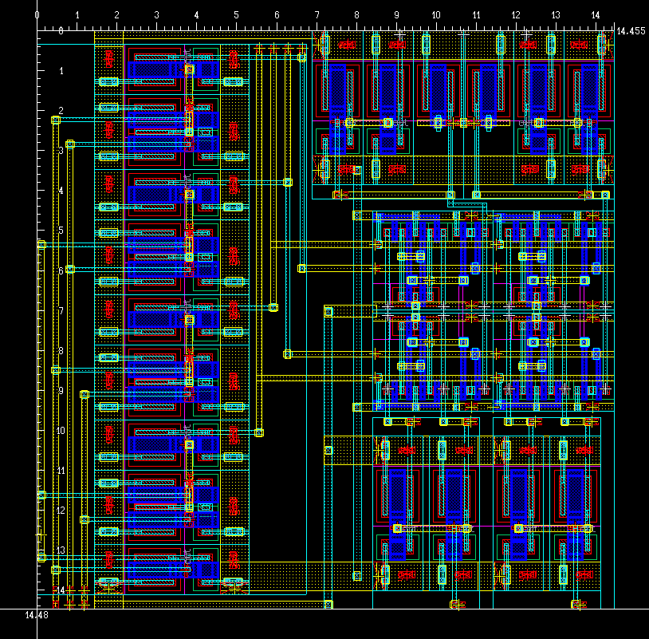
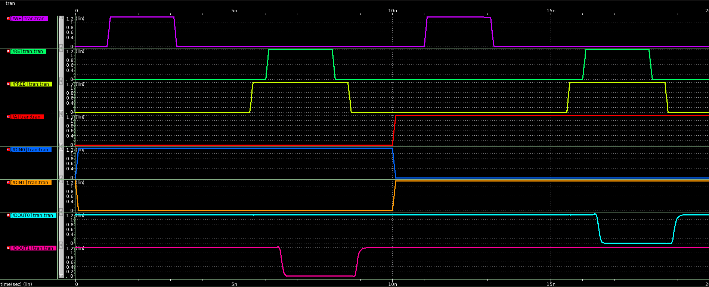

# 8T SRAM macro

Full-custom 8T SRAM using the 90 nm `reference90RF` PDK. The macro stores
two 2-bit words and includes a row decoder, write drivers, and single-ended
read buffers with bitline precharge.

## Source layout

| Path | Purpose |
| --- | --- |
| [`ram8t_custom/`](ram8t_custom/) | OpenAccess schematics, symbols, layouts, and testbenches |
| [`simulation/`](simulation/) | HSPICE decks for the bitcell and macro |
| [`verification/`](verification/) | Hercules, StarRC, and HSPICE results |
| [`docs/`](docs/) | Schematics, layout captures, and waveforms |

## Test and build

With Synopsys Custom Compiler installed, make the PDK library available at
`PDK/reference90RF` or edit its entry in `lib.defs`. Start Custom Compiler from
the repository root and open `ram8t_full/layout` in the `ram8t_custom` library.
Use `ram8t_full_test/schematic` for the macro testbench.

Run the four HSPICE decks with the PDK models to check both the schematic and
the StarRC netlists. The bitcell test reads back 1 and 0 at 0.8 V. At 1.2 V the
macro test writes and reads back `10` at address 0 and `01` at address 1.
See the [simulation commands](simulation/README.md) and
[readback voltages](verification/hspice/readback.csv).

## Bitcell SNM

HSPICE measured the bitcell static noise margin (SNM) at 1.0 V and 25 °C.

| Mode | SNM (mV) |
| --- | ---: |
| Hold | 307.197 |
| Read | 307.199 |
| Write 0 | 435.000 |

The write value is the side length of the square in the remaining butterfly
lobe. The sweep uses the bitcell transistor sizes in a separate DC circuit.
StarRC parasitics apply only to the transient DUT.

In Custom Compiler, open SAE for `ram8t_cell_test/config`. Add
[`snm_include.sp`](simulation/snm_include.sp) under **Setup > Include Files**
with type **Options**. Enable **Import Measures** in the **Outputs** tab
and run **Simulation > Netlist and Run**. See the
[SAE setup](simulation/README.md#snm-in-custom-compiler) for the model files
and the [HSPICE output](verification/hspice/bitcell-snm.ms0) for the values.

## Layout and verification

| Block | Dimensions (µm) | Area (µm²) |
| --- | ---: | ---: |
| Bitcell | 3.030 × 2.470 | 7.4841 |
| 2×2 array | 6.060 × 5.010 | 30.3606 |
| Macro with periphery | 14.455 × 14.480 | 209.3084 |

Hercules reports clean DRC and a passing LVS comparison for all three blocks.
The standalone array also has one `ERR_TEXT_OPEN` in its LVS layout report.
The extracted netlists have StarRC short reports and HSPICE floating-bulk
warnings. See the [verification reports](verification/README.md).

## License

This project is licensed under the Apache License 2.0. See [LICENSE](LICENSE).
